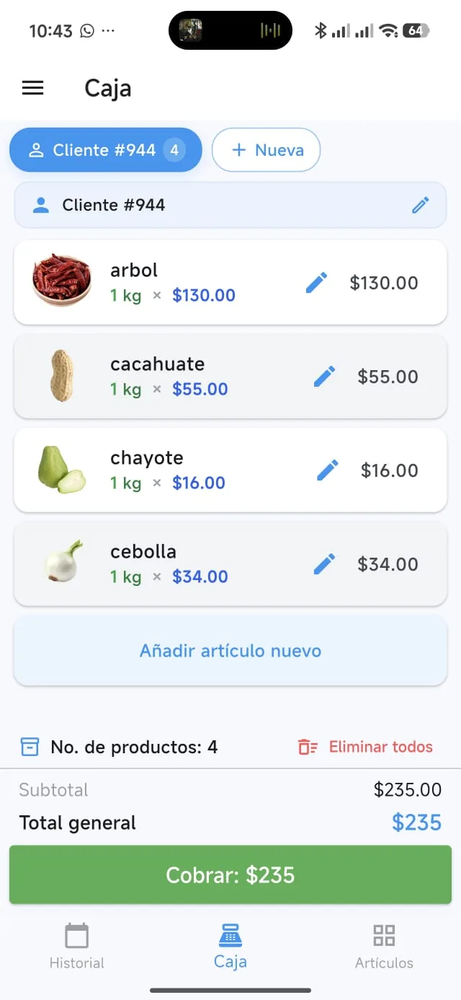
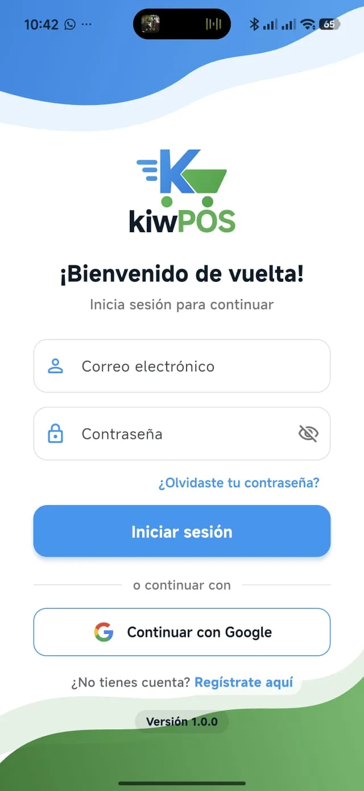
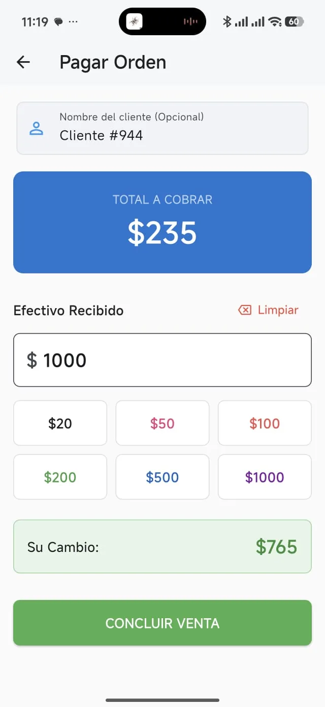
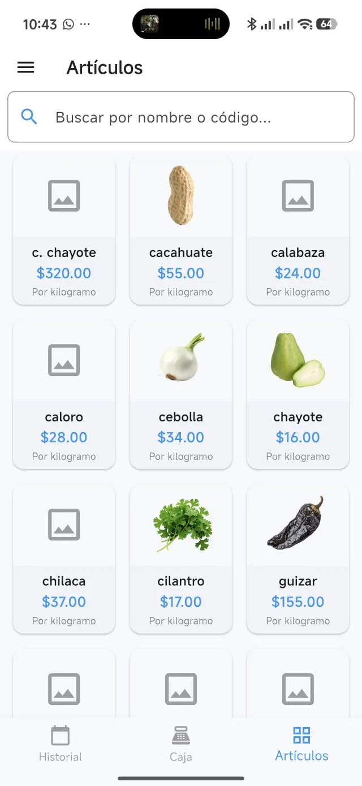

# KiwPOS · Aplicación móvil de ventas y punto de venta

Proyecto personal desarrollado en **junio de 2026** para digitalizar la elaboración de notas y tickets en un negocio de la Central de Abastos. **KiwPOS** está desarrollado en **Flutter/Dart** y permite registrar artículos, armar pedidos, calcular importes y generar recibos.

Este repositorio contiene el **código Dart compartido para portafolio académico y profesional** y fotografías reales de la aplicación. **No es una distribución instalable ni un proyecto Flutter completo**: el archivo compartido originalmente solo contenía `lib/`, `pubspec.yaml` y `pubspec.lock`.



## Problema que atiende

El proceso anterior utilizaba notas escritas a mano, lo que podía producir errores en cantidades, precios y cálculos. El proyecto buscó simplificar el registro de productos y la generación de tickets.

## Funcionalidades visibles en el código

- Gestión y consulta de artículos, con categorías y búsqueda.
- Caja, registro de productos, cálculo de totales y flujo de cobro.
- Generación, consulta y edición de tickets o recibos; salida mediante impresión Bluetooth y PDF.
- Historial de ventas y utilidades de importación/exportación de catálogo.
- Registro e inicio de sesión mediante Firebase Authentication, incluida opción con Google.
- Control de acceso, estados de suscripción/membresía y sesiones de usuario en Cloud Firestore.
- Persistencia de datos operativos en SQLite mediante `sqflite`.

**Alcance de la verificación:** las funciones anteriores se identificaron al revisar el código fuente. No se ejecutó la aplicación ni se hicieron pruebas de hardware o impresión.

## Stack tecnológico

| Área | Tecnologías |
| --- | --- |
| Aplicación móvil | Flutter, Dart |
| Datos locales | SQLite, paquete `sqflite` |
| Acceso y cuentas | Firebase Authentication, Google Sign-In |
| Suscripciones y sesiones | Cloud Firestore |
| Impresión y documentos | Bluetooth térmico, `pdf`, `printing` |
| Desarrollo | Android / Flutter (archivos nativos no incluidos en este ZIP) |

## Capturas reales

| Pantalla de inicio de sesión | Caja |
| --- | --- |
|  |  |

| Cobro | Catálogo |
| --- | --- |
|  |  |

## Estructura compartida

```text
KiwPOS-GitHub/
├── lib/
│   ├── main.dart
│   ├── db/
│   ├── screens/
│   ├── services/
│   ├── utils/
│   └── widgets/
├── capturas/
├── pubspec.yaml
├── pubspec.lock
├── firebase_config.example.json
├── .gitignore
└── README.md
```

## Cómo integrar el código en un proyecto Flutter local

1. Instala Flutter y el SDK de Android compatible con tu equipo.
2. Parte de **tu copia original** del proyecto Flutter, o crea un proyecto Flutter nuevo y configura la plataforma Android y sus permisos. Este ZIP **no contiene** las carpetas originales `android/`, `assets/` y otros archivos de plataforma, por lo que no puede ejecutarse por sí solo.
3. Copia `lib/`, `pubspec.yaml` y `pubspec.lock` de este repositorio al proyecto local preparado.
4. Si deseas generar íconos, recupera la imagen original declarada en `pubspec.yaml` (`assets/icon/kiwpos_icon.png`) o ajusta esa sección.
5. Ejecuta `flutter pub get` y configura las integraciones nativas necesarias para Firebase, Google Sign-In y Bluetooth en Android.
6. Copia `firebase_config.example.json` a **`firebase_config.local.json`**, completa los valores de tu propio proyecto Firebase y configura las reglas de seguridad de Firestore y los proveedores de autenticación.
7. En el proyecto local preparado, ejecuta:

```powershell
flutter run --dart-define-from-file=firebase_config.local.json
```

`firebase_config.local.json` está excluido de Git. La versión pública usa `String.fromEnvironment` para evitar dejar identificadores reales de Firebase y OAuth directamente en el código compartido.

**Nota:** estos pasos son orientativos; el proyecto público es una muestra de código, no una compilación verificada. Pueden ser necesarias configuraciones adicionales del proyecto original y versiones compatibles de las bibliotecas.

## Privacidad y seguridad

- Se retiraron del código público los identificadores concretos de Firebase y Google OAuth, así como los valores predeterminados del nombre y la dirección del negocio.
- No se incluyen bases de datos con ventas reales, usuarios, credenciales, claves privadas, ni archivos de servicios de Firebase.
- Las restricciones de acceso y membresías implementadas en el cliente **no reemplazan** las reglas de seguridad de Cloud Firestore. No se incluyeron las reglas de seguridad del backend y no se ha auditado su configuración.
- No subir capturas con información personal de clientes o credenciales.

## Demo

**No hay demo web pública**: el proyecto original es una aplicación móvil. Las capturas y el código permiten evaluar su funcionalidad y arquitectura.

## Reconocimientos

Proyecto de práctica personal aplicado a una necesidad de un negocio real; no se afirma que tenga premios o certificaciones.

## Autor

**Juan Emmanuel Rosales Fernández** · Ingeniería Informática, ITESI.

[Portafolio profesional](https://brocoly7w7.github.io/portafolio-juan-emmanuel/) · [GitHub](https://github.com/Brocoly7w7)
